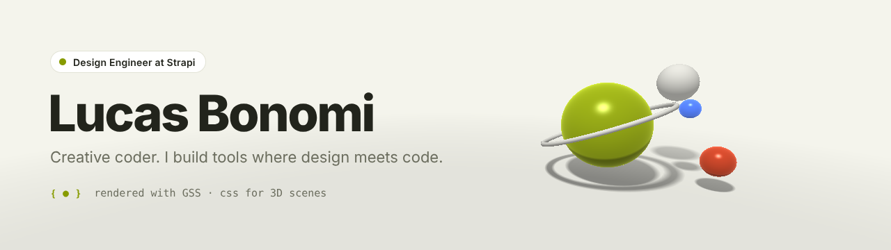

<a href="https://lucasbonomi.com">
  <picture>
    <source media="(prefers-color-scheme: dark)" srcset="./assets/banner-dark.webp">
    
  </picture>
</a>

 

I am a design engineer and creative coder. I work where design and code meet: CSS, shaders, design systems and the tools around them.

Now I am a **Senior Design Engineer at [Strapi](https://strapi.io)**. Before that, I spent 9 years at **[Algolia](https://www.algolia.com)**. I joined as one of the first 20 employees.

### Now

- **[GSS](https://github.com/LukyVj/GSS)**: GPU Style Sheets. A CSS-like language for 3D scenes. It compiles selectors, the cascade and keyframes into one raymarching shader for WebGPU and WebGL2. → [gss-lang.dev](https://www.gss-lang.dev)
- **[Skillify](https://github.com/LukyVj/skillify)**: turn any technical post into a skill for your AI agent. → [getskillify.dev](https://getskillify.dev)
- **Strapi**: design and front-end work on the open-source headless CMS.

### Selected open source

| Project | What it does | |
| --- | --- | --- |
| [family.scss](https://github.com/LukyVj/family.scss) | Sass mixins for `:nth-child` selectors, made easy |  |
| [Colorify.js](https://github.com/LukyVj/Colorify.js) | A tiny JavaScript color extractor |  |
| [colofilter.css](https://github.com/LukyVj/colofilter.css) | Duotone filters in pure CSS |  |
| [menu-to-cross-icon](https://github.com/LukyVj/menu-to-cross-icon) | One idea, six CSS animations |  |
| [accecss](https://github.com/LukyVj/accecss) | A Sass mixin that checks the accessibility of your designs |  |

### Elsewhere

[lucasbonomi.com](https://lucasbonomi.com) · [X / Twitter](https://x.com/LukyVj) · [Stack Overflow](https://stackoverflow.com/users/1331432/lukyvj)

The banner is a GSS scene, rendered headless. Source: [`banner/`](banner).
